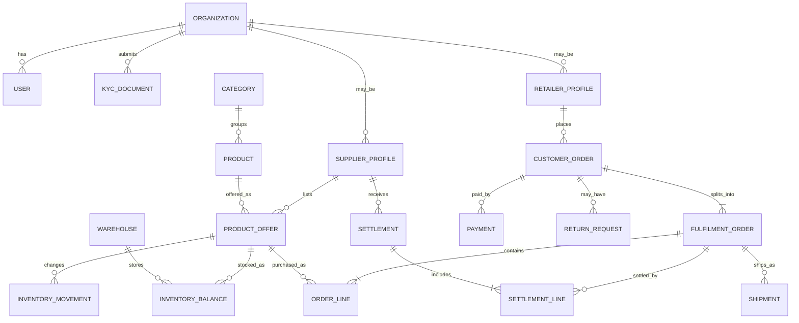

# Agri-One Project Blueprint

**Version:** 0.1 draft  
**Business:** B2B agriculture input marketplace with Agri-One-owned wholesale stock  
**Initial operating area:** Cooch Behar and Alipurduar, West Bengal  
**Languages:** English and Bengali

## 1. Product direction

Agri-One connects agricultural suppliers with retailers through a business marketplace. Retailers can discover products from two clearly identified sources:

1. **Marketplace supply:** a manufacturer, distributor or wholesaler owns the inventory and fulfils the supplier order. Agri-One earns an agreed commission or service fee.
2. **Agri-One wholesale:** Agri-One buys and owns stock, then sells it to retailers. The sale, inventory and margin belong to Agri-One.
3. **Farmer services:** a later service line for membership, soil testing and agriculture support.

The two product supply paths must remain distinguishable through catalogue, checkout, accounting, returns and settlement. A retailer's checkout may create one parent order and separate fulfilment orders for each supplying party.

## 2. People and applications

| Application | Main users | Main responsibilities |
| --- | --- | --- |
| Public website and retailer web experience | Retailers, prospective farmers, suppliers | Explain the network, browse public catalogue details, check enquiry service, apply and sign in |
| Retailer mobile application | Retailers | KYC, product discovery, pricing, cart, checkout, orders, ledger, support |
| Supplier portal/application | Manufacturers, distributors, wholesalers | Business verification, catalogue submissions, inventory, pricing, order acceptance, dispatch and settlement statements |
| Admin web dashboard | Operations, catalogue, finance, support, compliance staff | Approvals, users, catalogue, pricing, orders, payments, returns, settlements, staff and reporting |
| Delivery and operations system | Warehouse and logistics teams | Pick/pack, batch capture, shipment allocation, delivery proof, exceptions and reconciliation |

All applications should use one identity and authorization service, while exposing only the permissions appropriate to the user's role and organization.

## 3. Initial release recommendation

Keep the first operational release narrow enough to run in Cooch Behar and Alipurduar while preserving the multi-supplier model in the data design.

### Retailer MVP

- Retailer registration, mobile verification and KYC status.
- Product discovery by category, brand, supplier, stock source and PIN-code serviceability.
- Supplier-specific price, minimum order quantity, pack size and available quantity after sign-in.
- Cart that groups lines by supplying party and shows separate fulfilment expectations.
- Order placement, payment or approved payment terms, GST invoice, shipment status and support request.
- Order and payment history, including a clear retailer ledger for any approved credit account.

### Supplier and operations MVP

- Supplier application and admin verification.
- Product submission and admin approval.
- Supplier price/MOQ/stock maintenance and order acceptance.
- Admin order desk with supplier purchase-order generation, shipment and delivery updates.
- Settlement statement for marketplace orders; Agri-One purchase and sales records for own-stock orders.
- Basic role-based permissions and audit history for sensitive changes.

### Defer until the core flow is reliable

Farmer membership and soil testing, advanced promotion rules, automated credit scoring, complex warehouse replenishment, route optimization, deep analytics and pan-India serviceability automation.

## 4. Core business workflows

### Supplier onboarding and listing

Supplier application → document and business verification → supplier account approval → product submission → catalogue/compliance review → approved listing → supplier sets price, MOQ, stock and service PIN codes → listing becomes visible to eligible retailers.

### Retailer onboarding and purchase

Retailer registration → mobile verification → KYC submission → admin review → account-specific product pricing unlocked → retailer searches and filters catalogue → serviceability and MOQ checks → cart is split by supplier/stock owner → payment or approved terms → order confirmation and GST invoice.

### Fulfilment and settlement

For each supplier order: purchase order or supplier fulfilment request → supplier accepts/rejects → pick and batch allocation → dispatch and tracking → delivery confirmation or exception → payment reconciliation → supplier settlement net of agreed commission/fees.

For Agri-One-owned stock: reserve warehouse inventory → pick and record batch/expiry → dispatch → delivery confirmation or return → reconcile retailer payment and Agri-One inventory/COGS.

### Returns

Return request references the delivered order line and supplying party. The responsible party, return window, lot/batch, evidence, pickup, refund/credit note and inventory disposition must be tracked independently. Policy details are a business decision and must be configured before launch.

## 5. Data and accounting boundaries

- Every product offer has a `seller_id`, `fulfilment_source` (`MARKETPLACE` or `AGRI_ONE_STOCK`), supplier SKU, price, MOQ, stock and serviceability.
- A retailer order is the customer-facing parent record. Child fulfilment orders are partitioned by seller, source and warehouse.
- Marketplace settlement entries are separate from Agri-One purchase, inventory, COGS and sales entries.
- Stock movements are append-only records referencing warehouse, product, batch and reason. The available quantity is derived from accepted stock movements and active reservations.
- Batch number and expiry are required for product types where lot traceability applies; the exact category rules need business and regulatory review.
- Price, tax, shipping, commission and payment terms are snapshotted onto the order line so later catalogue edits do not change historical transactions.

## 6. Suggested application architecture

Start with a **modular monolith API** and a relational database. This keeps the first release operationally manageable while modules can be separated if usage later requires it.

- **Web:** Next.js public website and admin dashboard, with responsive retailer web pages as a fallback to mobile.
- **Mobile:** React Native or Flutter retailer application; decide after confirming team skills and offline requirements.
- **API:** versioned REST API grouped into identity, organizations/KYC, catalogue, pricing, inventory, orders, payments, logistics, returns, settlements, notifications and reporting.
- **Database:** PostgreSQL with tenant/organization ownership on supplier, retailer and staff records; use database transactions for checkout, stock reservation and payment state changes.
- **Files:** private object storage for KYC documents, product documents and delivery evidence; short-lived signed access, malware scanning and retention controls.
- **Async work:** background jobs for OTP/email/SMS, payment callbacks, invoice generation, supplier notifications, settlement preparation and shipment updates.
- **External integrations:** payment gateway, SMS/OTP, email, maps/pincode service, logistics providers and GST invoicing should sit behind provider adapters so a vendor can be changed without rewriting order logic.
- **Operations:** separate development/staging/production environments, encrypted backups, audit logs, monitoring, error reporting and a documented restore drill.

These are proposed defaults, not purchased services or final infrastructure commitments.

## 7. Core entity relationship sketch

The final physical schema should include immutable status/event history for order, payment, shipment, KYC and approval workflows, plus audit records for price, stock and permission changes.

## 8. Security and operational requirements

- Role-based access control must include organization scope; staff permissions should be granted by role and limited by operational need.
- Enforce HTTPS, secure session/token handling, rate limits, input validation, CSRF protections where applicable and secret management outside source control.
- Encrypt KYC files at rest and in transit, restrict access, record access events, and define retention/deletion rules before collecting real documents.
- Verify payment gateway callbacks cryptographically and make payment/order operations idempotent to handle retries safely.
- Record audit history for supplier approval, product approval, pricing, inventory adjustment, refunds, settlements and staff access changes.
- Backups must be encrypted and restore-tested. Production access and deployment must be separated from routine development access.
- GST, pesticide/fertilizer/seed licensing, labelling, invoicing, returns and data retention requirements need review by qualified local advisors before production launch.

## 9. Project phases and acceptance gates

| Phase | Deliverable | Exit gate |
| --- | --- | --- |
| 0. Discovery | Confirm user roles, policies, launch products, payment terms, supplier contracts, delivery model and licensing responsibilities | Signed-off requirements, process maps and commercial assumptions |
| 1. Product design | English/Bengali UX, web/mobile flows, clickable prototypes and accessibility review | Retailer, supplier, operations and finance walkthrough approval |
| 2. Foundation | Identity, organizations, KYC states, roles, catalogue and supplier offers | Verified users can access only permitted data; approved offers appear correctly |
| 3. Order MVP | Cart split, checkout, supplier acceptance, stock reservation, invoice and shipment status | End-to-end test orders reconcile from retailer order through fulfilment and payment |
| 4. Operations | Warehouses, batch/expiry, returns, retailer ledger and supplier settlements | Finance and operations reconcile marketplace and Agri-One stock paths separately |
| 5. Scale | Farmer services, promotions, analytics, additional districts/states, integrations and performance work | Service, support and finance operations meet agreed service levels |

## 10. Commercial and delivery decisions to settle before a vendor agreement

The brief correctly calls for explicit terms. The contract and SOW should name the accepted milestone outputs, review/acceptance windows, payment schedule, change-control process, delivery dates and dependencies. It should also define source-code and IP transfer, third-party licenses/accounts, data ownership and export, hosting/maintenance ownership, security incident handling, backup/restore targets, warranty severity and response times, post-launch support, and exit/handover assistance.

The project estimate cannot be responsibly fixed until the following are decided: expected launch catalogue size and suppliers; whether payments are collected by Agri-One or suppliers; credit policy; commission and settlement rules; who issues the GST invoice for each supply model; cancellation/return policy; warehouse ownership; delivery fee/subsidy and PIN-code serviceability rules; and the first supported payment/logistics providers.

## 11. Current code status

The current repository contains a **public website prototype only**. The catalogue, supplier labels, enquiry shortlist, PIN-code response and onboarding confirmation are demonstration UI with no database, authentication, order placement, KYC upload, supplier system, payment or logistics connection. Do not use the sample listings or statuses as live business commitments. The prototype's purpose is to review the Agri-One public-facing direction before wiring real services.
